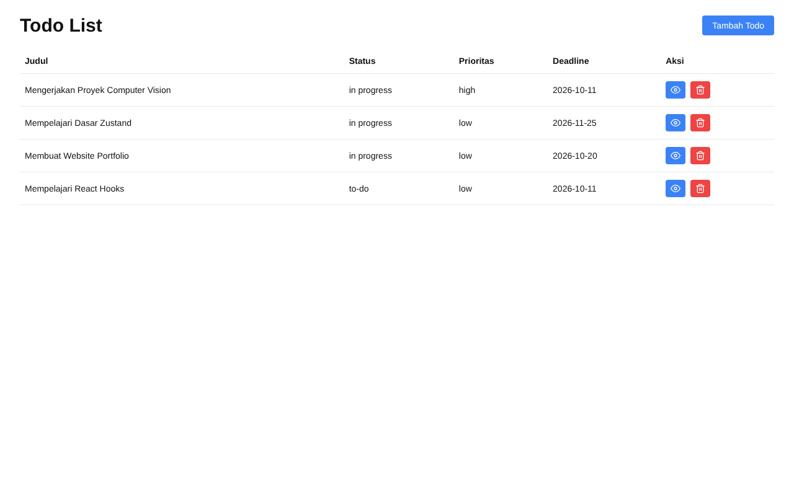
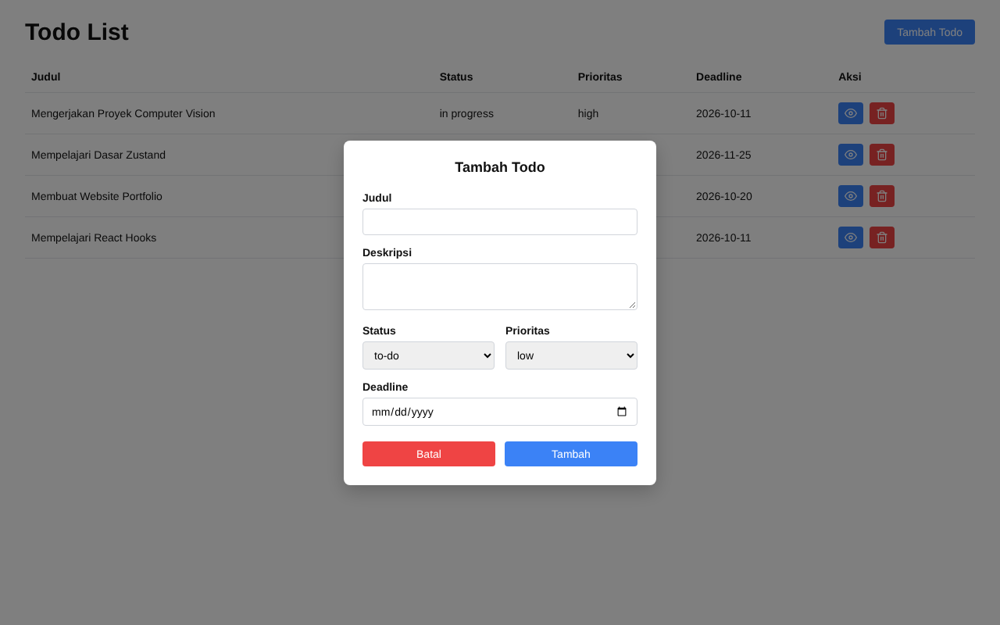
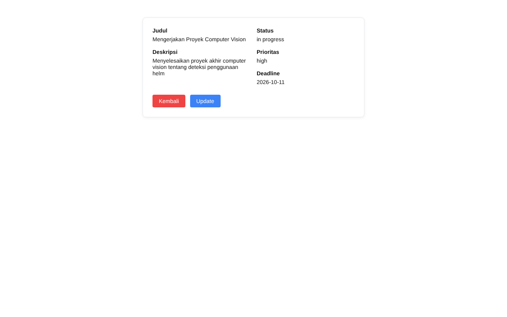
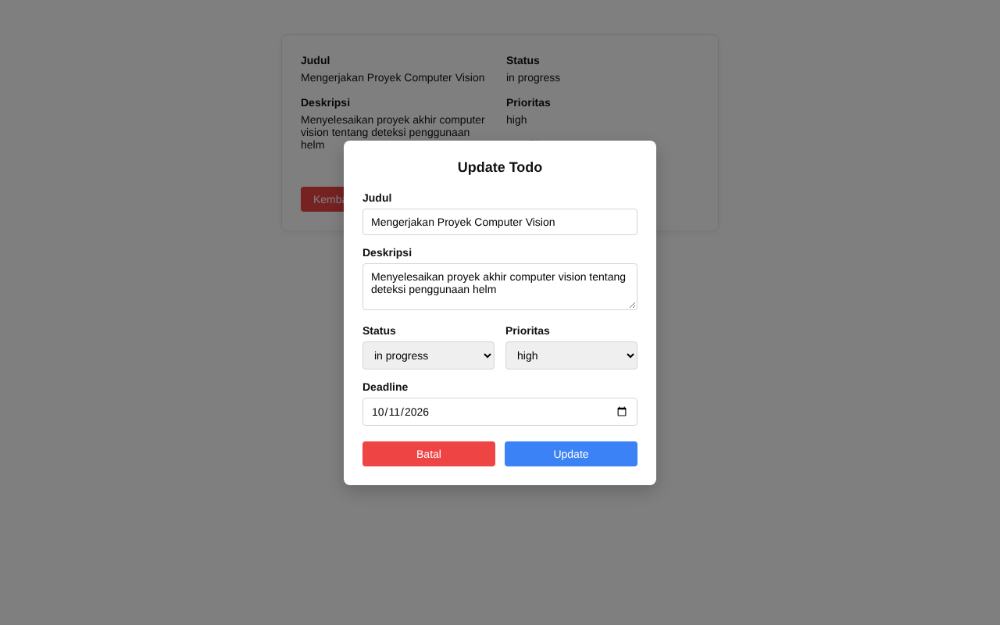
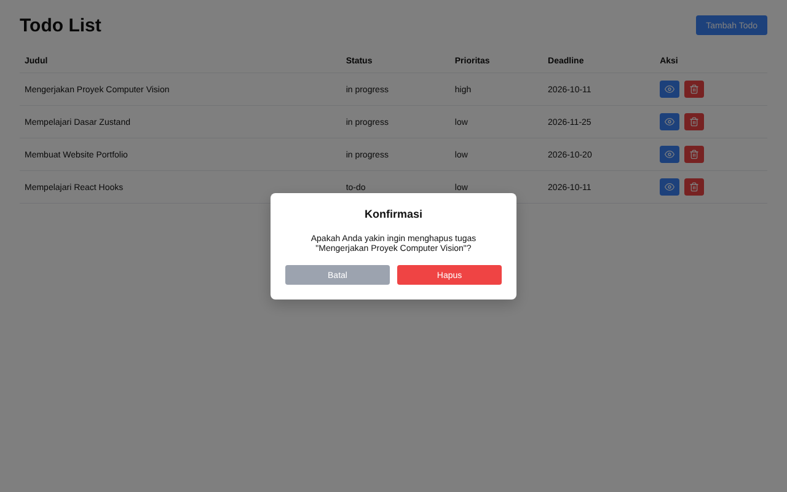

# Todo List - React.js

Aplikasi **To-Do List** untuk mengelola daftar tugas sehari-hari. Dibangun
menggunakan **React.js** (Vite) dan **React Router**. Seluruh pengerjaan hanya
pada bagian _frontend_ dengan **data dummy** dan pengelolaan data memakai
**React State** (tanpa pemanggilan REST API / backend).

## Fitur

- **Menampilkan Tugas** — menampilkan daftar tugas beserta informasinya dalam bentuk tabel.
- **Melihat Detail Tugas** — melihat informasi lengkap sebuah tugas pada halaman detail (`/todo/:id`).
- **Menambahkan Tugas** — menambah tugas baru melalui formulir (modal).
- **Memperbarui Tugas** — mengubah informasi tugas yang sudah ada.
- **Menghapus Tugas** — menghapus tugas dengan konfirmasi terlebih dahulu.

Setiap operasi (tambah, ubah, hapus) langsung tercermin pada tampilan tanpa
perlu memuat ulang halaman karena dikelola dengan React State.

## Struktur Data Tugas

Setiap tugas memiliki atribut sesuai ketentuan:

| Atribut     | Keterangan                   |
| ----------- | ---------------------------- |
| id          | Identitas unik tugas         |
| title       | Judul tugas                  |
| description | Deskripsi tugas              |
| priority    | Tingkat prioritas tugas      |
| deadline    | Batas waktu penyelesaian     |
| status      | Status pengerjaan tugas      |

## Teknologi

- React.js 18
- React Router DOM 6
- Vite

## Cara Menjalankan

```bash
npm install
npm run dev
```

Lalu buka `http://localhost:5173` pada browser.

## Struktur Folder

```
src/
├── main.jsx                   # Entry point + BrowserRouter
├── App.jsx                    # Routing + state utama (CRUD)
├── index.css                  # Styling
├── data/
│   └── todos.js               # Data dummy
├── pages/
│   ├── TodoList.jsx           # Halaman daftar tugas
│   └── TodoDetail.jsx         # Halaman detail tugas
└── components/
    ├── TodoFormModal.jsx      # Modal form Tambah & Update
    └── ConfirmModal.jsx       # Modal konfirmasi hapus
```

## Screenshot Hasil Implementasi

### Daftar Tugas


### Tambah Tugas


### Detail Tugas


### Perbarui Tugas


### Konfirmasi Hapus

